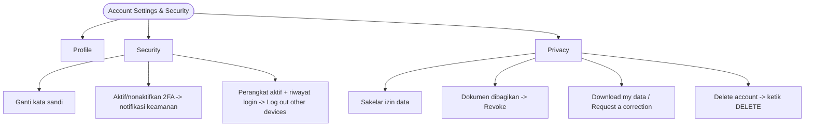

# UF1: Alur Account & Security

## Langkah

1. Profile: ubah data pribadi; ubah email/telepon memerlukan OTP ulang; lihat status e-KYC (NIK disamarkan).
2. Security: ganti kata sandi (lama + baru + konfirmasi), kelola 2FA, lihat perangkat aktif dan riwayat login, keluar dari perangkat lain.
3. Privacy: sakelar izin data, daftar dokumen yang dibagikan + Revoke, unduh data, minta koreksi, hapus akun (ketik DELETE).
