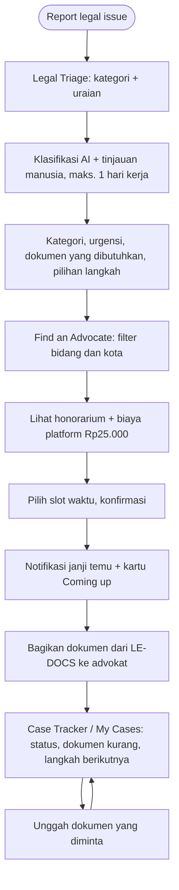

# UF1: Alur pemesanan advokat

## Langkah

1. Member membuka Find an Advocate (dari menu atau hasil triase/contract review).
2. Menyaring berdasarkan bidang dan kota.
3. Kartu advokat: nama, bidang, kota, kanal (daring/tatap muka), honorarium per sesi, status terverifikasi.
4. Book consultation: total = honorarium advokat + biaya platform Rp25.000, lalu pilih slot waktu.
5. Konfirmasi: notifikasi janji dibuat dan muncul di kartu Coming up.
6. Member Paket Karyawan: 1 konsultasi 30 menit per tahun sudah tercakup.

## Catatan

Advokat yang memberi nasihat hukum. Honorarium advokat diteruskan utuh. Nama advokat di prototipe adalah contoh.
