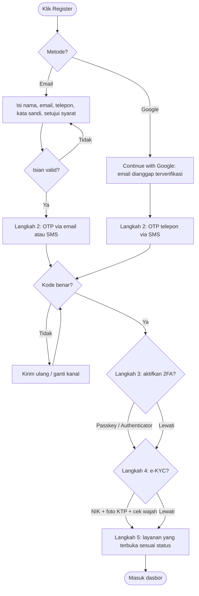

# UF1: Alur Register

## Langkah

1. Pengguna membuka `/register` dan memilih daftar dengan email atau Google.
2. Jalur email: isi nama lengkap, email, telepon (+62), kata sandi, konfirmasi kata sandi, dan centang persetujuan Syarat & Kebijakan Privasi.
3. Sistem memvalidasi isian.
   - Gagal: pesan di bawah field yang salah.
   - Email atau telepon sudah terdaftar: pesan khusus dan tautan ke login.
4. Sistem menyimpan akun dengan status belum terverifikasi, lalu mengirim OTP 6 digit lewat email atau SMS.
5. Pengguna memasukkan OTP. Salah: pesan galat, bisa kirim ulang setelah hitung mundur atau ganti kanal.
6. OTP benar: akun terverifikasi. Langkah 3 (2FA) dan 4 (e-KYC) boleh dilewati.
7. Langkah 5 menampilkan layanan yang terbuka sesuai status, lalu tombol ke dasbor.

## Catatan

Tingkat akses di langkah 5 masih usulan (lihat `prd.md` §7). Sampai vendor OTP dipilih, kode ditampilkan di konsol/layar (simulasi).
