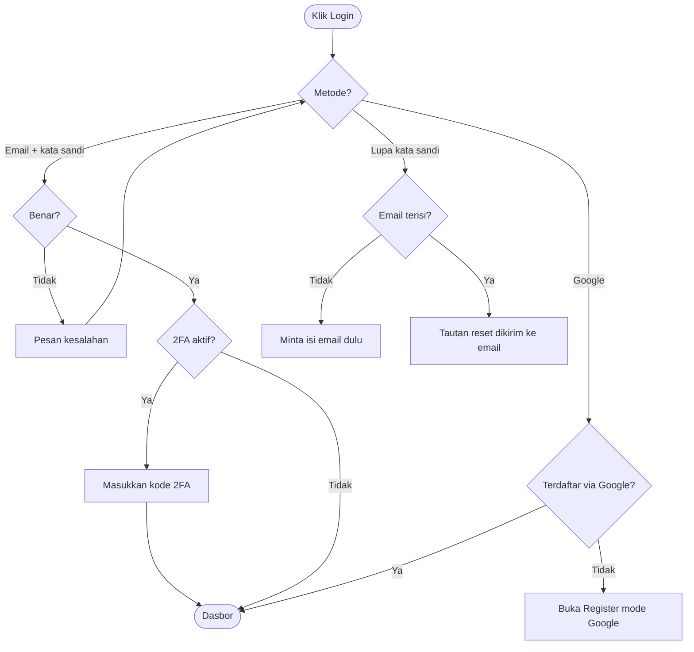

# UF2: Alur Login

## Langkah

1. Pengguna membuka `/login`.
2. Masuk dengan email + kata sandi, *passkey*, atau Google.
3. Kata sandi salah: pesan galat umum (tidak menyebut field mana yang salah).
4. Bila 2FA aktif, modal meminta kode 6 digit dari aplikasi *authenticator* atau *passkey*.
5. Sukses: sesi dibuat (JWT di cookie httpOnly), arahkan ke `/dashboard`, catat riwayat login.
6. Google belum terdaftar: arahkan ke register mode Google.
7. Lupa kata sandi: email harus terisi, lalu tautan reset dikirim.
