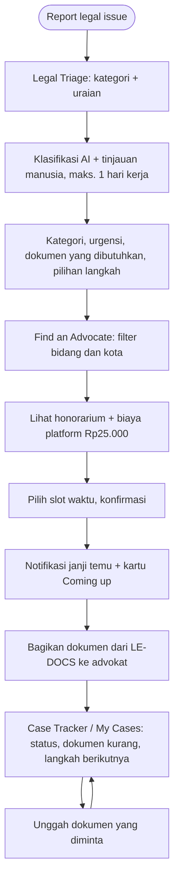

# UF1: Alur Case Tracker

## Langkah

1. Kasus dibuat dari Legal Triage dengan ID (format LI-TTTT-NNNN).
2. Status bergerak: Reported → Classified → In review → With advocate → Closed.
3. Daftar dokumen yang diminta; dokumen kurang ditandai dan bisa diunggah dari LE-DOCS.
4. Langkah berikutnya dan tenggat (misalnya jadwal konsultasi) tampil di atas.
5. Setiap perubahan status dan tenggat mengirim notifikasi.

## Catatan

Advokat yang memberi nasihat hukum dan mewakili pengguna. Le-Insure menangani triase, pencocokan, jadwal, dokumen, dan status.
