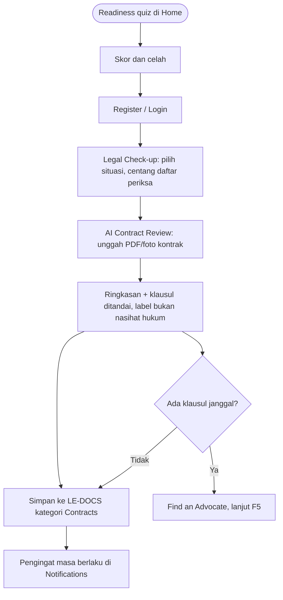

# UF1: Alur Legal Check-up

## Langkah

1. Member membuka Legal Check-up.
2. Memilih situasi: menyewa, bekerja, jual-beli daring, punya tanah/kendaraan, menikah, punya anak.
3. Sistem menampilkan daftar periksa sesuai situasi, tiap butir berstatus Siap atau Belum.
4. Member mencentang butir; progres diperbarui.
5. Ringkasan menampilkan langkah berikutnya (misalnya unggah kontrak sewa ke LE-DOCS, periksa kontrak dengan AI).
6. Semua selesai: pesan "Review again when your situation changes."
