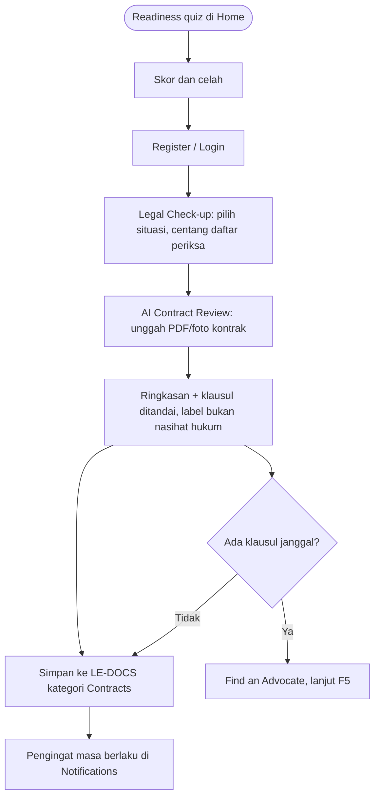

# UF1: Alur AI Contract Review

## Langkah

1. Member mengunggah PDF/foto kontrak atau memilih dari LE-DOCS, lalu memilih jenis (sewa, kerja, pribadi).
2. Sistem menampilkan ringkasan (para pihak, jangka waktu, nilai) dan klausul yang ditandai (Review/Info) dengan penjelasan bahasa awam.
3. Label tetap: AI hanya menandai klausul, bukan nasihat hukum.
4. Member menyimpan ke LE-DOCS kategori Contracts, atau lanjut ke Find an Advocate bila ada klausul janggal.
