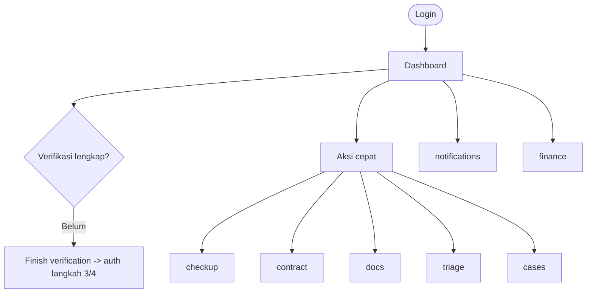

# UF1: Alur beranda dasbor

## Langkah

1. Setelah login, member masuk `/dashboard`.
2. Sapaan sesuai waktu + nama depan.
3. Kartu status: verifikasi (kontak, 2FA, e-KYC) dengan "Finish verification", skor perlindungan (%), paket, keamanan.
4. Aksi cepat: Start legal check-up, Review contract, Upload document, Report legal issue, View my cases.
5. Kartu Coming up (janji advokat terdekat), pusat notifikasi (jumlah belum dibaca), ringkasan uang.
6. Akses cepat ke My Protection, LE-DOCS, Legacy Planning, My Cases, Finance, Account & Security.
