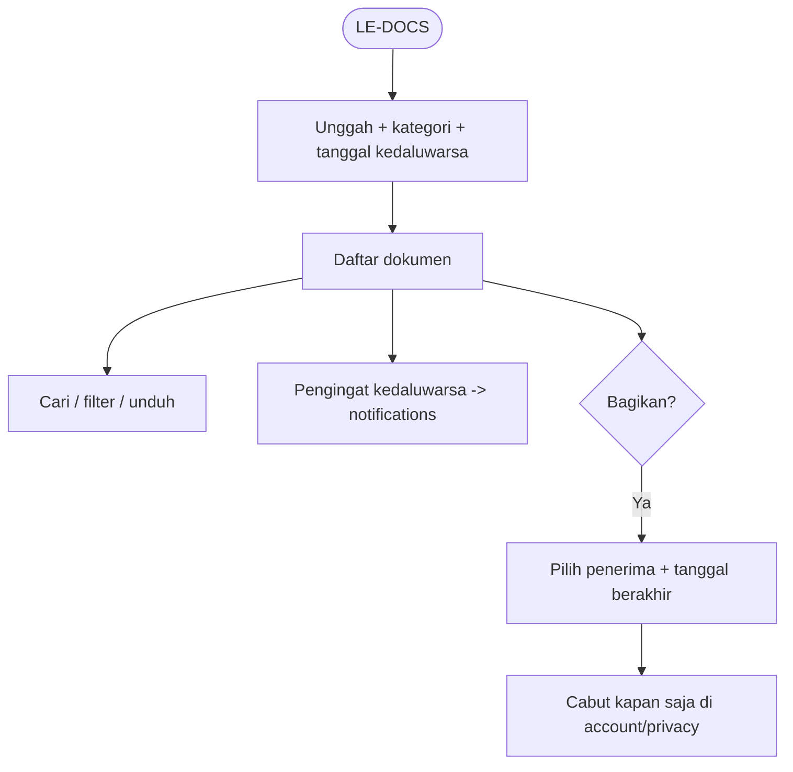

# UF1: Alur LE-DOCS

## Langkah

1. Member membuka LE-DOCS dan melihat kuota (1 GB Basic, 20 GB Plus).
2. Unggah dokumen dan pilih kategori: Personal, Family, Property & Assets, Contracts, Insurance; isi tanggal kedaluwarsa bila ada.
3. Cari dan saring dokumen; unduh per dokumen.
4. Pengingat kedaluwarsa muncul di LE-DOCS dan notifikasi.
5. Bagikan dokumen ke advokat/notaris dengan tanggal berakhir; akses bisa dicabut di Privacy.
