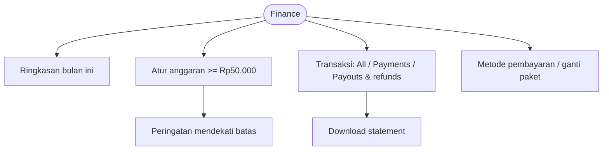

# UF1: Alur Finance

## Langkah

1. Member membuka Finance: ringkasan bulan ini (paket, biaya platform, honorarium, tagihan berikutnya).
2. Menetapkan anggaran hukum bulanan (minimal Rp50.000); peringatan saat mendekati batas.
3. Melihat transaksi per tab (All, Payments, Payouts & refunds) dan mengunduh laporan.
4. Mengganti metode pembayaran atau paket.

## Catatan

Alur pembayaran nyata masih celah; di MVP transaksi adalah data contoh.
