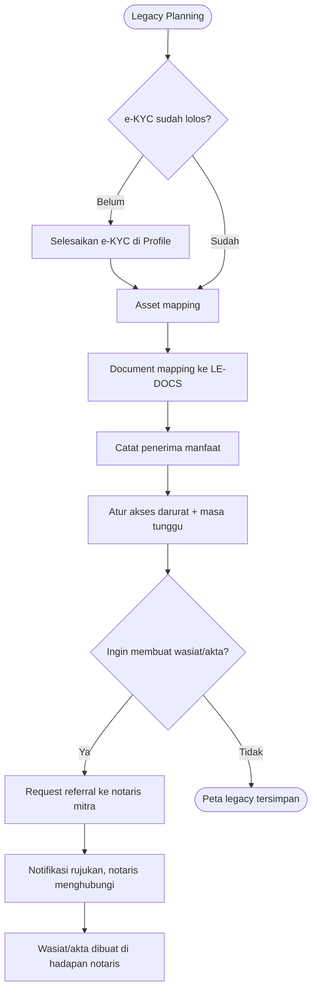

# UF1: Alur LE-LEGACY

## Langkah

1. Member membuka Legacy Planning; bila e-KYC belum lolos, diarahkan menyelesaikannya.
2. Asset mapping: catat properti, rekening, polis, barang berharga, beserta lokasi dokumennya.
3. Document mapping: tautkan aset ke dokumen LE-DOCS; tampilkan dokumen yang belum ada.
4. Catat penerima manfaat dan hubungannya.
5. Atur akses darurat: kontak tepercaya + masa tunggu yang bisa ditolak pemilik.
6. Opsional: minta rujukan notaris mitra.

## Catatan

Teks tetap di setiap layar: LE-LEGACY bukan pengganti wasiat. LE-LEGACY hanya mencatat keberadaan dan lokasi dokumen.
