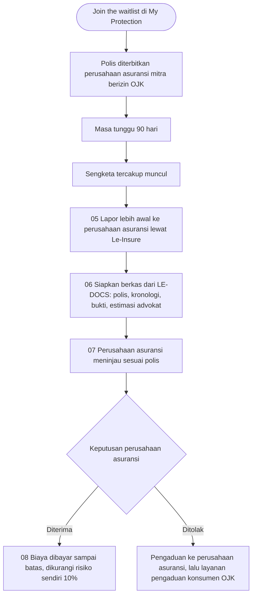

# UF1: Alur LPP

## Langkah

1. Member membuka Legal Protection Plan: status "Not active yet".
2. "Join the waitlist" / "Leave waitlist".
3. Fase 2: polis diterbitkan perusahaan asuransi mitra, masa tunggu 90 hari.
4. Fase 2: klaim (langkah 05–08) diajukan ke perusahaan asuransi lewat Le-Insure dengan berkas dari LE-DOCS.

## Catatan

Di prototipe, hanya langkah daftar tunggu yang bisa diklik. Langkah 05–08 baru dijelaskan di halaman Claims & Assistance.
