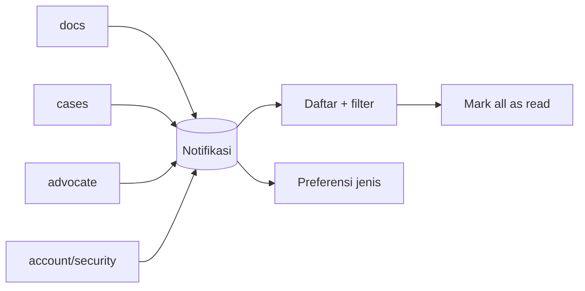

# UF1: Alur Notifications

## Langkah

1. Fitur lain membuat notifikasi (kedaluwarsa kontrak/dokumen, status kasus, janji advokat, polis, keamanan).
2. Ikon lonceng dan menu menampilkan jumlah belum dibaca.
3. Member menyaring (All, Unread, Security) dan menandai semua sudah dibaca.
4. Member mengatur jenis notifikasi yang ingin diterima.
