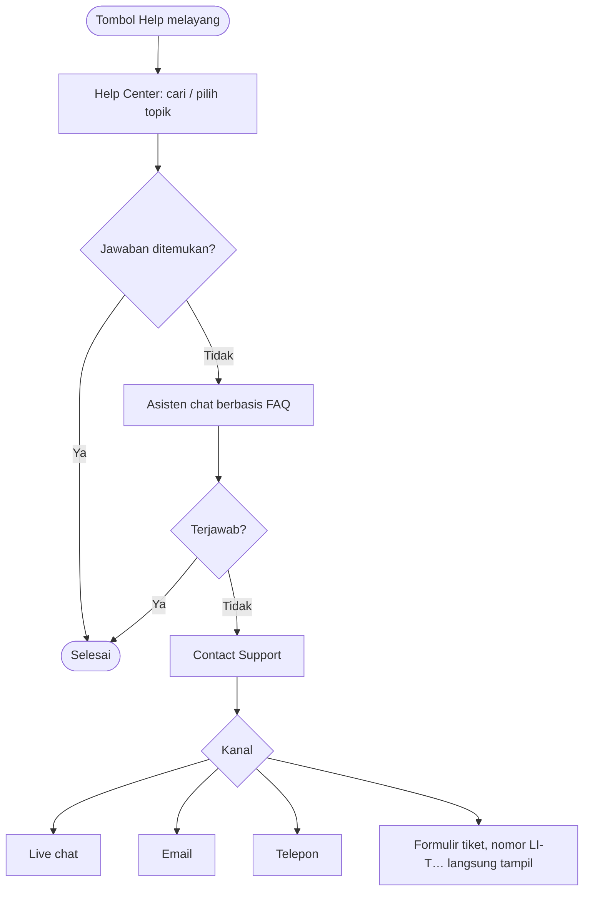

# UF1: Alur bantuan

## Langkah

1. Tombol Help melayang membuka Help Center: pencarian, 6 topik, FAQ.
2. Belum terjawab: asisten chat berbasis FAQ.
3. Masih belum: Contact Support dengan kanal live chat, email, telepon, atau formulir tiket.
4. Tiket langsung mendapat nomor (format LI-T…).
5. Keluhan klaim diarahkan ke perusahaan asuransi dulu, lalu layanan pengaduan konsumen OJK.
