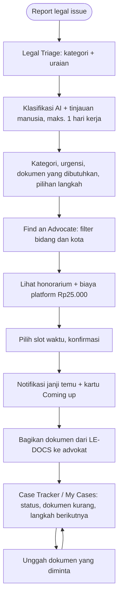

# UF1: Alur Legal Triage

## Langkah

1. Member menekan "Report legal issue".
2. Langkah 1–4: kategori, uraian kejadian, kapan mulai, nilai sengketa (Rp), urgensi.
3. Klasifikasi AI ditinjau manusia; balasan maksimal 1 hari kerja.
4. Hasil: kategori, urgensi, dokumen yang perlu disiapkan, pilihan langkah (advokat mitra atau rujukan bantuan hukum gratis).
5. Laporan tersimpan di My Cases dengan ID kasus.

## Catatan

Advokat yang memberi nasihat hukum dan mewakili pengguna. Le-Insure menangani triase, pencocokan, jadwal, dokumen, dan status.
