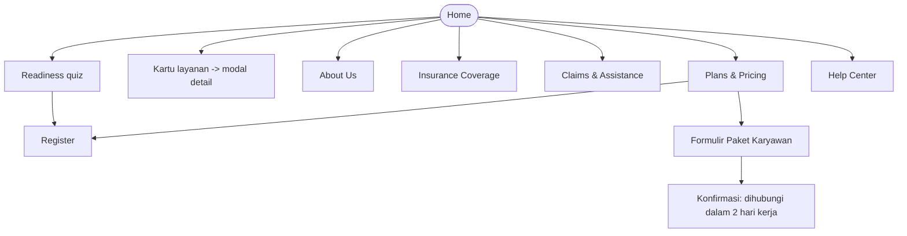

# UF1: Navigasi website publik

## Langkah

1. Pengunjung mendarat di Home: *hero* globe + tagline, *ticker* Daily insights, Our Services (Prepare, Protect, Preserve).
2. Kartu layanan membuka modal detail (apa yang didapat, siapa melakukan apa, batas peran).
3. "Check your readiness" membuka kuis 5 pertanyaan, hasilnya skor 0–100 dan layanan yang disarankan.
4. Navigasi: About Us, Insurance Coverage, Claims & Assistance, Plans & Pricing, Login, EN/ID, tema.
5. Plans & Pricing: pilih paket lalu register; "Start with Employee Package" membuka formulir minat korporat.
6. Tombol Help melayang membuka Help Center (lihat `support/`).

## Catatan

Pengajuan Paket Karyawan: formulir saja. Dasbor SDM, aktivasi karyawan, dan SSO kantor adalah celah.
